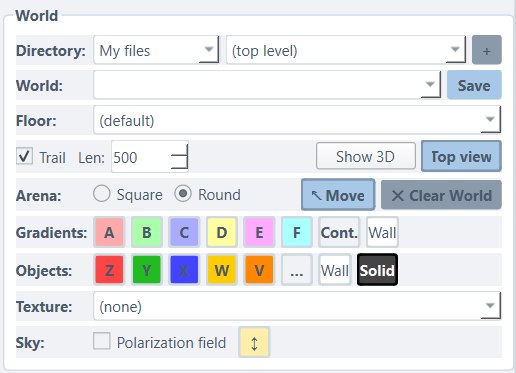
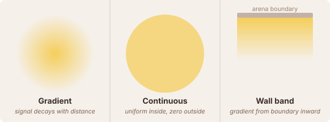
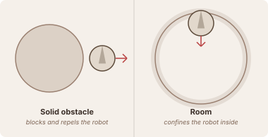
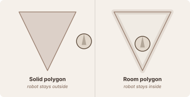
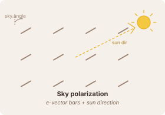

# Creating Worlds

The **arena** is the environment your robot lives in. It can contain gradient fields that sensors detect, solid obstacles that block movement, and a sky polarization pattern for compass experiments. Everything you place is saved with the session config and reloaded automatically on the next run.

All world editing happens in the **World** tab of the control panel. Changes take effect immediately — you can reshape the world while the brain is running.

---

## World file

Saves and loads the arena independently of the session and brain.

**Dir** — choose **My files** or **🔒 Simulator** (read-only built-in worlds), then a folder inside it. **+** creates a new folder.
**World** — lists the JSON files in the chosen folder; selecting one loads it immediately.
**Save** — opens a dialog: pick a folder and type a name, with a live preview of the destination path. Saving a Simulator world writes your own copy instead of overwriting the original.

---

## Floor

Selects a texture for the floor, drawn from your `textures/` folder. **(default)** keeps the built-in checker pattern. The floor texture is visible in the MuJoCo **Top view** and **Show 3D** views only — the flat 2D canvas does not render textures.

---

## Trail and 3D views

**Trail** — enables the position trail drawn in the arena. **Len** sets how many past positions are kept (10–5000).

**Show 3D** — opens a separate MuJoCo 3D viewer window (enabled when MuJoCo is running).

**Top view** — replaces the flat 2D canvas with a MuJoCo overhead render. Object editing still works in this mode; switch back to 2D to see gradient patches.

---

## Arena

**Square / Round** — sets the arena boundary shape. Round is the default; Square gives four flat walls instead of a circular perimeter.

**↖ Move** — toggle. While active, drag any gradient patch, solid object, or robot disc to a new position. You can also **Alt+drag** directly from any other tool without switching to Move mode first.

**✕ Clear World** — removes all gradient patches and objects (walls stay), after asking for confirmation.

---

## Gradient fields

Gradient patches are invisible stimulus fields — the robot passes through them freely, but sensors like `GradientSensor` detect their signal.

Each patch has a **label** (A–F) and a matching **colour** (A = red, B = green, C = blue, D = yellow, E = magenta, F = cyan). Sensors subscribe to a label; a sensor set to label `A` reads only patches labelled `A`. Multiple patches with the same label stack by maximum — the sensor receives the highest reading over all of them.

### Gradient (default)

Signal decays linearly from 1.0 at the centre to 0.0 at the edge:

$$\text{sig} = \max\!\left(0,\; 1 - \frac{d}{r}\right)$$

**To place:** click one of the letter buttons (**A–F**) in the *Gradients* row, then drag on the arena (drag start = centre, drag end = radius).

### Continuous

Same shape, but the signal is a flat 1.0 everywhere inside the radius and drops to exactly 0.0 at the boundary. Useful for food zones where stimulus intensity should not depend on position within the patch.

**To place:** toggle **Cont.** on before dragging.

### Wall band

A gradient that emanates from the arena boundary inward. It covers the entire perimeter — there is no centre point. Useful as a looming-wall input for avoidance behaviours.

**To place:** click **Wall** in the *Gradients* row, then drag (the drag distance sets the band width).

### Mounted gradient

A gradient patch that follows a specific robot. Place it by starting your drag from inside that robot's body disc. Useful for interoceptive signals ("smell of self") or for creating a scent field another agent can track — see the courtship scenario in [Braitenberg Vehicle III](tutorials/second-braitenberg.md#what-to-try-next).

---

## Solid objects

Circular objects that physically block the robot. The simulator pushes the robot out on contact. Distance, collision, whisker, and camera sensors all detect solid objects.

**Colours** — five presets (**Z** red, **Y** green, **X** blue, **W** yellow, **V** orange) plus a **…** custom colour picker.

**Wall** — switches drawing to polygon-wall mode (see below).

**Solid / Room** — toggles the object type for the next placed circle:

- **Solid** — a filled obstacle the robot stays outside.
- **Room** — the robot is kept *inside* the circle. Rendered as an annular ring. Toggle **Solid** off to activate Room mode.

**To place:** select a colour, choose Solid or Room, then drag on the arena (drag start = centre, drag end = radius).

### Texture

Assigns a texture image to objects and polygon walls placed afterward. Textures are PNG files in `textures/` in your files folder. **(none)** = flat colour only. Textures render in the MuJoCo Top view and Show 3D only.

---

## Polygon walls

Freehand polygon boundaries drawn by clicking vertices on the arena. The polygon closes automatically when you click near the first vertex (or after at least 3 points). Hold **Shift** to snap edges to 45° increments. Right-click while drawing to cancel.

The **Solid / Room** toggle on the Objects row controls whether the polygon is a wall the robot stays outside (Solid, filled) or a boundary the robot stays inside (Room, hollow band).

**To draw:** click **Wall** in the *Objects* row, then click vertices on the arena.

---

## Sky polarization

A global celestial field that the `SkyCompassSensor` reads. It has no physical presence and does not affect any other sensor.

Tick **Polarization field** to enable it. Click **↕** and drag on the arena to set the e-vector angle. The sun direction is perpendicular to the e-vector: `sun_dir = sky.angle + π/2`.

---

## Sensor interaction table

| Object type | GradientSensor | ColorSensor | DistanceSensor | CollisionSensor | WhiskerSensor | CameraSensor | SkyCompassSensor |
|---|---|---|---|---|---|---|---|
| Gradient circle | ✓ | — | — | — | — | — | — |
| Continuous circle | ✓ | — | — | — | — | — | — |
| Wall band | ✓ | — | — | — | — | — | — |
| Solid obstacle | — | ✓ | ✓ | ✓ | ✓ | ✓ | — |
| Room circle | — | ✓ | ✓ | ✓ | ✓ | ✓ | — |
| Polygon wall | — | — | ✓ | ✓ | ✓ | ✓ | — |
| Sky field | — | — | — | — | — | — | ✓ |

---

## Tips

- **Right-click** any placed object to delete it.
- **Alt+drag** a patch or obstacle directly from any draw tool to reposition it without switching to Move mode.
- **Ctrl+drag** duplicates a patch or obstacle — the clone (same radius, colour, label) follows the cursor; the original stays put.
- **Shift** while repositioning or duplicating snaps to a grid spaced by the **Grid size** setting in the Physics tab. The grid always aligns to arena centre `(0, 0)`. **Ctrl+Shift**-drag is the quickest way to build a pair of exactly mirrored stimuli.
- Multiple gradient patches with the same label stack by maximum, not sum. Overlap several patches to widen a field without raising its peak intensity.
- Sessions save the entire world state (patches, objects, walls, sky, floor, arena shape). Use **Session tab → Save** to snapshot it.
