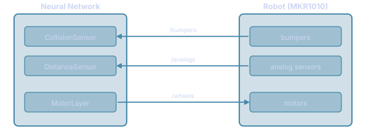

# Running Networks on the Real Robot

The simulator can drive a live robot using the same brain you designed in simulation — no code changes required. In **real-robot mode** the real robot takes the place of the simulated world: sensor values come from the robot's actual hardware, and motor commands go out over the network each step.



Each sensor in the network listens for a specific OSC message that the robot sends; the motor layer sends a `/wheels` command back. The brain itself is unchanged — only the source of sensor values and the destination of motor commands switch from simulation to the real robot.

---

## Connecting the network to the robot

The key idea is that each **sensor** and each **motor layer** in your network has a `robot_address` field that ties it to a specific OSC message on the robot.

- A sensor's `robot_address` tells the simulator which OSC message to listen for, which arguments to extract, and optionally how to convert raw hardware values into the normalised range the network expects.
- A motor layer's `robot_address` tells the simulator where to send the wheel command each step.

When robot mode is enabled the simulator opens one UDP socket per unique address, starts receiving sensor packets in the background, and sends motor commands at ~60 Hz — all without any change to the brain itself.

### Sensor lines

The robot sends sensor data as periodic OSC packets over UDP. Each packet has a fixed structure: the first argument is a packet counter, followed by the actual sensor readings. A sensor's `robot_address` encodes all the information needed to decode it:

```
host:port/osc_path[type_tag](i,j,...){formula}
```

| Part | Meaning |
|---|---|
| `host:port` | Robot IP and port — also the local port the simulator binds to receive packets |
| `/osc_path` | The OSC address to filter on (e.g. `/bumpers`, `/analogs`) |
| `[type_tag]` | Expected OSC argument types, e.g. `iiiii` — used for validation |
| `(i,j,...)` | Zero-based indices of the arguments to extract; count must match the sensor's `n` |
| `{formula}` | Optional Python expression to convert raw values; `x` is the extracted array |

For example, the robot's `/analogs` packet carries five integers (packet counter + four ADC readings). To connect a two-neuron distance sensor to ADC channels A1 and A6, and convert their 0–1023 raw range to approximately [0, 2]:

```
192.168.0.224:2390/analogs[iiiii](1,4){x/500}
```

Index 0 is skipped (packet counter), indices 1 and 4 are the two ADC channels, and `x/500` does the conversion.

### Motor lines

The motor layer simply needs the robot's IP, port, and the OSC address it listens on for wheel commands:

```
192.168.0.224:2390/wheels
```

The simulator sends `/wheels int vleft int vright` to that address each step. No indices or formula — the brain's output goes directly to the robot.

---

## Worked example — DistanceCollisionResponse brain

The **DistanceCollisionResponse** brain (`networks/RobotBrains/DistanceCollisionResponse`) uses two sensors and a motor layer wired to the MKR1010 robot at `192.168.0.224:2390`.

The robot sends bumper contact states on `/bumpers` and analog ADC readings on `/analogs`. The brain connects each network element to a specific slice of those packets:

| Network element | `robot_address` | What it reads |
|---|---|---|
| `CollisionSensor` (bumper, n=2) | `192.168.0.224:2390/bumpers[iiiii](1,2)` | Front-left and front-right bumpers (indices 1–2; index 0 is the packet counter) |
| `DistanceSensor` (sensor1, n=2) | `192.168.0.224:2390/analogs[iiiii](1,4){x/500}` | IR sensors on A1 and A6, raw ADC converted to [0, 2] |
| `MotorLayer` (motor, n=2) | `192.168.0.224:2390/wheels` | Left and right wheel duty, sent to the robot each step |

Both sensors share the same port so the simulator opens a single socket and dispatches incoming packets to whichever sensor's `/osc_path` matches.

The packet layouts for reference (index 0 is always the packet counter):

| OSC address | [0] | [1] | [2] | [3] | [4] |
|---|---|---|---|---|---|
| `/bumpers` | pkt | pin 0 | pin 8 | pin 10 | pin 13 |
| `/analogs` | pkt | A1 | A2 | A5 | A6 |
| `/wencoders` | pkt | enc1 Δ | enc2 Δ | — | — |

---

## Real-time `dt`

In simulation mode `dt` is fixed (`SimConfig.dt`, default 20 ms). In robot mode it is the actual wall-clock interval between successive steps, measured with `time.perf_counter()`. The first tick of a session falls back to the configured `dt`.

This keeps leaky-neuron time constants (`tau_rise`, `tau_decay`) correctly calibrated to wall-clock seconds rather than sim ticks.

---

## Motor output

Each step's wheel command is clamped to [−100, 100], rounded to integers, and sent as `/wheels int vleft int vright` to every motor layer's `robot_address`.

Keyboard control (WASD) works exactly as in simulation: while active, its command is sent instead of the brain's, but the brain keeps running and the visualizer reflects what is actually driving the robot.

---

## Configuring sensors in the network editor

Open the sensor or motor layer properties (double-click in the network visualizer) and set the **Robot address** field. The Robot tab in the side panel shows each registered address and its live update rate (Hz) once robot mode is enabled.

Sensors with an empty `robot_address` are silently ignored — they receive a zero array each step, and the network keeps running with those inputs silent.
