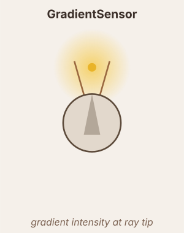

# GradientSensor

Casts `n` rays in a fan and reads gradient intensity at each tip.

$$\alpha_i = \text{center\_angle} + \text{fan}(i, n, \text{angle\_spread})$$

$$p_i = \bigl(x + d\cos(\theta+\alpha_i),\; y + d\sin(\theta+\alpha_i)\bigr)$$

$$r_i = \text{gradient}(p_i,\; \text{label}) \times \text{scale}$$

`gradient = 'A'`…`'F'` — responds to that label only; a new sensor starts on **A**. `gradient = ''` — responds to all labels. `color_channel = 'R'/'G'/'B'` — single channel.

## Output pipeline

$$\tau = \begin{cases}\tau_{rise} & r > x \\ \tau_{decay} & r \leq x\end{cases}, \quad \frac{dx}{dt} = \frac{r - x}{\tau}$$

$$\text{output} = f(x) \quad (\text{or}\ f(r)\ \text{if no dynamics})$$

## Neuromodulation

Receptors (`modulators`) and the transmitter act on the sensor's [neuron stage](index.md#neuron-stage) (the **Neuron** tab of its dialog), not on the reading itself.
