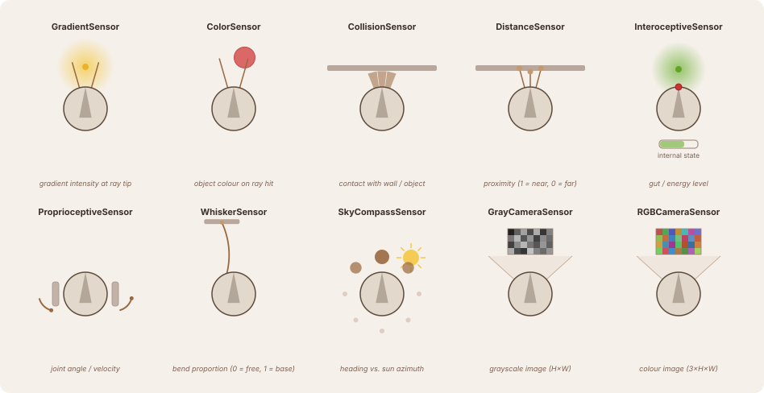

# Sensors

Each sensor reads a different aspect of the robot's environment and produces a vector of outputs the network can use. The diagram below shows all sensor types and the physical quantity each one measures.

Select a sensor from the left panel for full parameter reference and equations.

## Settings every sensor shares

Every sensor's reading goes through the same steps as a neuron layer, in this order: `bias` → noise (`noise_std`, `noise_tau`, see [Noise](../layers/leaky.md#noise)) → `output_mode` (derivative or integral of the reading) → leaky filter (`tau_rise`, `tau_decay`) → `activation` → `scale`.

The time constants follow the same rules as layers:

| Setting | Meaning |
|---|---|
| `tau_rise` 0 or blank | Instant rise — the output jumps straight to the reading while it's rising, then eases down with `tau_decay` while falling |
| `tau_decay` 0 or blank | Instant decay — the output eases up with `tau_rise` while rising, then jumps straight down to the reading while falling |
| both set | Rises with `tau_rise`, falls with `tau_decay` |
| both 0 or blank | No filtering at all — the reading passes straight through |

With `output_mode = derivative`, the output is 0 on the first step, since there is no previous reading yet.

## Neuron stage

Every sensor is followed by its own neuron stage: a [LeakyLayer](../layers/leaky.md) that takes the sensor's output as input. The sensor's properties dialog has two tabs, each starting with a sentence on what its settings are for. **Sensor** opens first; **Neuron** is marked **Neuron ●** when the neuron stage is in use (not pass-through, or it has modulators or a transmitter).

| Tab | What it sets |
|---|---|
| **Sensor** | *Transduction* — how the world is read: geometry, `bias`, `scale`, noise, `tau_rise` / `tau_decay`, `activation`, `output_mode` — the steps above |
| **Neuron** | *First-order neuron* — the neuron the sensor drives: its own `bias`, `scale`, `activation`, `tau_rise` / `tau_decay`, noise, `output_mode`, plus the modulator receptors and the transmitter |

The neuron stage is what the rest of the network reads, and it's where connections can land: draw a connection onto a sensor and it is summed into the neuron stage's input, exactly as for a layer:

$$u = \text{sensor output} + \sum_k W_k \cdot \text{input}_k$$

- **Pass-through by default.** `bias` 0, `scale` 1, `linear`, no time constants — a sensor with no connections and an untouched Neuron tab behaves exactly as before.
- **Neuromodulation acts here.** `site = pre` scales the neuron stage's input (sensor output plus connections), `site = post` its output. The transmitter publishes the neuron stage's output.
- **Lateralized sensors.** Each half (`name_L`, `name_R`) runs through its own copy of the neuron stage, so a connection can target one half.
- **Timing.** Sensors are read before the network steps, so a connection from a layer onto a sensor carries that layer's output from the previous step — the same one-step delay as any recurrent connection.

Networks saved before the neuron stage existed load unchanged. For a sensor with a `pre` modulator and a non-linear activation, the activation and `scale` move to the Neuron tab on load, which gives exactly the old result.
