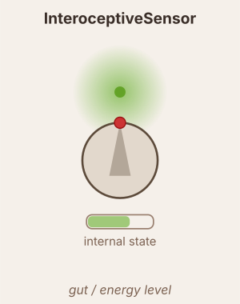

# InteroceptiveSensor

Samples gradient intensity at the **mouth** (heading angle 0) and integrates what is eaten into an internal satiation state, which digestion slowly drains.

## Pipeline

**1. Sample** — $r \in [0,1]$: maximum gradient intensity within `body_radius` of the mouth point.

**2. Scale & clip:**

$$s_{\text{target}} = \text{clip}(r \times \text{scale},\; 0,\; 1) \times \text{max\_val}$$

- `scale` controls mouth sensitivity: it sets how fast a given patch intensity is eaten.
- `max_val` is the ceiling of the internal state.

**3. Eat & digest** — a leaky integrator. Intake fills the gut while digestion drains it, so fullness reflects how much has been eaten (time × intensity), not how much food is under the mouth right now:

$$\frac{ds}{dt} = \frac{s_{\text{target}}}{\tau_{rise}} - \frac{s}{\tau_{decay}}$$

- `tau_rise` — seconds to fill from empty while eating at full intensity (0 = instant).
- `tau_decay` — digestion time constant; 0 = no digestion (pure integrator). Should be ≫ `tau_rise` for realistic hunger.

A long stay at the weak edge of a patch fills the gut as surely as a short meal at its centre.

**4. Clip & output:**

$$\text{output} = \text{clip}(s,\; 0,\; \text{max\_val}) + \text{bias}$$

- `start_val` — initial value of $s$ at reset (0 = empty stomach, `max_val` = full).
- `bias` — constant offset added every tick. Use negative to encode a hunger drive.

## Neuromodulation

Receptors (`modulators`) and the transmitter act on the sensor's [neuron stage](index.md#neuron-stage) (the **Neuron** tab of its dialog), not on the reading itself.
