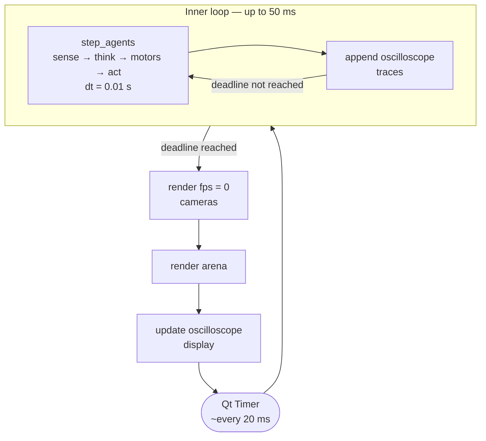
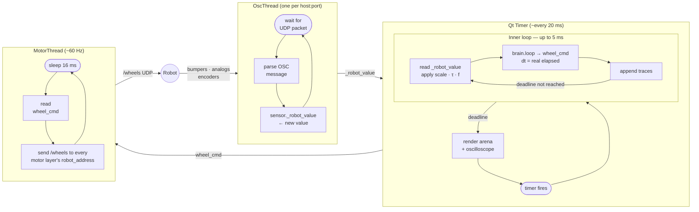

# Timing Architecture

The 2D simulator separates **physics/network stepping** from **display rendering** — and in real-robot mode, also from **sensor I/O** and **motor output**. This page describes the timing loops for both modes.

---

## Simulation mode

Because the inner loop runs many steps before handing control back to the GUI, the **network executes at ~200+ steps/s** (depending on step cost) while the **display updates at ~14 Hz**.

Cameras run on their own clock. A camera with `fps > 0` renders inside `step_agents` once per `1/fps` *simulated* seconds, so its frame rate is the same at any simulation speed. A camera with `fps = 0` renders as fast as possible — once per display cycle, after the inner loop — so it never holds up the per-step sensors.

| Component | Typical rate |
|---|---|
| Qt timer fires | ~14 Hz |
| `step_agents` (incl. `step_network`) | ~230 Hz |
| Camera, `fps > 0` | `fps` frames per simulated second |
| Camera, `fps = 0` | ~14 Hz (once per display cycle) |
| Arena repaint | ~14 Hz |
| Oscilloscope update | ~14 Hz |

---

## Real-robot mode

Three concurrent activities share the process. Each runs at its own rate, independent of the others.

| Thread | Rate | Driven by |
|---|---|---|
| OscThread | robot send rate (~60 Hz) | incoming UDP packets |
| Qt loop — network | as fast as possible, in 5 ms bursts | `ROBOT_BURST_S` deadline (5 ms) |
| MotorThread | ~60 Hz | fixed 16 ms sleep |

The robot-mode burst is short (5 ms, against 50 ms in simulation mode) because key presses are only handled between bursts: a long burst would delay manual driving by up to ~100 ms. The robot sends new sensor data only every ~17 ms, so 5 ms still runs the network several times per sensor update. The rate of `/wheels` messages to the robot does not depend on it: MotorThread sends the latest command at 60 Hz either way.

---

!!! note "Thread safety"
    The simulator relies on Python's GIL rather than explicit locks. Attribute reads and writes on primitive types are atomic at the bytecode level, which is sufficient here:

    - **Sensor values** — `OscThread` writes `sensor._robot_value`; the Qt thread reads it. A stale read is harmless: the value is at most one robot transmission cycle old.
    - **Motor commands** — `MotorThread` reads `wheel_cmd` (a tuple, replaced atomically) every 16 ms; the Qt thread writes it after each network step. In the worst case the robot receives a command one network step stale — well within motor latency tolerance.
    - **Display** — all rendering happens on the Qt thread; no cross-thread writes occur there.

    If you add state involving multi-attribute invariants (e.g. a weight matrix updated atomically with a bias vector), protect it with a `threading.Lock`.
