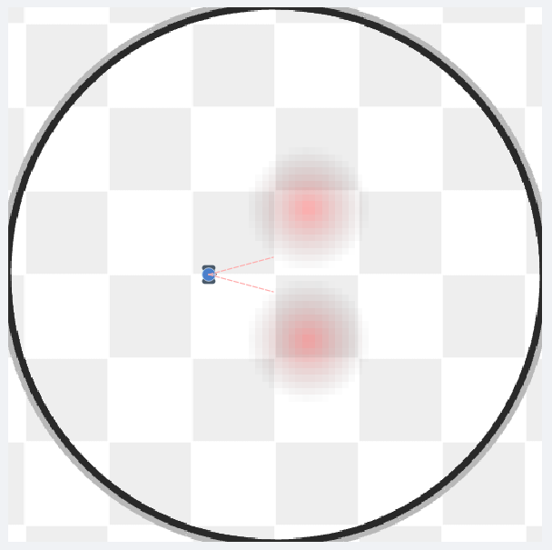

# Surviving in Buridan's World

**Buridan's ass** is a centuries-old thought experiment: a donkey stands exactly midway between two identical, equally appetizing bales of hay. With no reason to prefer either one, the story goes, it can never decide — and starves to death standing still.

This tutorial picks up from **[Braitenberg Vehicle III](second-braitenberg.md)** and puts its "love" circuit in exactly that bind: two identical gradient patches, placed as mirror images of each other. You'll see the direct wiring from Vehicle III fail the test outright — it has no way to break a perfect tie. Then you'll build two more vehicles, **Rivalry** and **Discriminator**, each adding one more idea on top of the last to decide with less and less sensor noise to go on.

**What you will build**

| Step | What happens |
|------|--------------|
| Add a second, mirrored patch | Two identical `A` patches, equidistant from the robot — the two bales of hay |
| Widen the steering wiring | Builds **Waverer**: a direct sensor→motor connection that computes a pure left-vs-right difference |
| Watch the tie | With both patches identical, the difference sits at zero and the robot drives straight between them |
| Insert a competing pair | Builds **Rivalry**: an `AdaptiveLayer` wired so its two neurons inhibit each other |
| Watch it decide | The competition amplifies the tiniest random imbalance into a committed turn toward one patch |
| Let the winner reach back | Builds **Discriminator**: two new connections that let the winning side suppress the losing eye's own signal, reinforcing the decision from two directions at once |

---

## Background — a tie needs something to break it

Every circuit you've built so far is purely feedforward: a sensor reading flows straight through to a motor command, instantaneously and deterministically. That's fine as long as the world only ever gives the robot one thing to react to. Put two *identical* things in front of it, symmetric left and right, and a feedforward circuit has nowhere to go — by construction, equal inputs produce equal (or exactly cancelling) outputs, forever.

Breaking a tie like that needs two ingredients: something that amplifies a small difference instead of just passing it through, and something to seed that difference in the first place. The amplifier is **mutual inhibition** — two neurons that each suppress the other — which turns any momentary edge, however small, into a growing one. The seed is the sensor's ordinary background noise, always present in every reading.

---

## Step 1 — Reopen your Vehicle III network

Launch the simulator and reopen the network you built in Vehicle III, with `light` (a `GradientSensor`, `n=2`, `gradient='A'`) wired for **approach** — `cruise` (a `ConstantLayer`, value `60`) feeding `motor` directly, and `light` inhibiting `motor` same-side (Vehicle III, [Step 5](second-braitenberg.md#step-5-make-the-sensor-inhibitory)).

!!! note "Skipped Vehicle III?"
    Build that starting point first: a `GradientSensor` named `light` (`n=2`, `gradient='A'`, `scale=60`), a `ConstantLayer` named `cruise` (`n=2`, `value=60`) wired to `motor` with the identity matrix, and `light → motor` wired same-side with weight `−1` on the diagonal. See [Braitenberg Vehicle III](second-braitenberg.md) for the full build.

---

## Step 2 — Give it two identical choices

Right now there's a single `A` patch in the world. You're about to give the robot two, placed as exact mirror images of each other.

1. Go to the **World** tab. If you don't already have an `A` patch placed ahead of the robot, place one now (as in Vehicle II/III).
2. Hold **Ctrl** and drag the patch — this clones it, the same size and colour, following your cursor while the original stays put.
3. Hold **Shift** at the same time to snap both the original and the clone to the grid (set the grid spacing in the Physics tab if you want finer control). Drop the clone so it mirrors the original across the robot's forward axis — if the original sits ahead and to the left, drop the clone the same distance ahead and to the right.

You should now have two identical `A` patches, the same distance from the robot, one on each side of the path straight ahead of it — the two bales of hay, equally far and equally appealing.

{ width=396 }

!!! tip "Give it room"
    If the arena feels cramped with two patches in it, increase **arena_scale** in the Physics tab so the robot has more distance to react before it reaches either one.

---

## Step 3 — No noise, no decision

Open `light`'s settings and set `noise_std = 0`. With both patches identical and no noise, the two eyes always read exactly the same value — the robot has no information at all to tip it either way.

Press **▶ Run**. The robot drives straight between the patches and never turns. This is Buridan's ass at its most literal: perfectly symmetric, perfectly stuck.

## Step 4 — Add noise

Now set `noise_std = 1.0` and press **▶ Run** again. The robot wobbles and commits to one side — not because the circuit is any smarter, but because noise breaks the symmetry.

!!! note "What `noise_std` means"
    Noise is injected after bias but before activation and scale. The raw gradient value is in [0, 1], so each eye receives:

    $$\tilde{s} = \text{activation}(s + b + \varepsilon) \times \text{scale}, \qquad \varepsilon \sim \mathcal{N}(0,\, \sigma^2)$$

    With `noise_std` = σ = 1.0, the noise is on the order of the sensor's full raw range — the two eyes are rarely identical for long.

Try stepping σ down in tenfold decrements — `0.1`, `0.01`, `0.001` — and watch how the robot's behaviour changes. At some point the robot will be unable to reliably go through the patch. Keep that threshold in mind: it is the question the rest of this tutorial is built around.

---

## Step 5 — Widen the steering wiring: Waverer

Keep `light`'s `noise_std` at the lowest level where the robot stopped committing reliably in Step 4 — that is the noise floor you are trying to beat.

One of evolution's recurring solutions to telling two similar stimuli apart is to rewire the same inputs so that small differences are amplified rather than passed through unchanged. In Vehicle III each motor neuron listens to only one eye; adding a crossed excitatory term means each motor neuron now receives excitation from one eye and inhibition from the other — the motor layer becomes the comparator, and what drives it is no longer each eye's absolute reading but the difference between them.

1. In the network visualizer, right-click the `light → motor` connection and choose **Edit weight…**.
2. Switch to **Manual** and enter:

    |  | `light_0` (left) | `light_1` (right) |
    |--|--|--|
    | `motor_0` (left wheel) | **−1** | **+1** |
    | `motor_1` (right wheel) | **+1** | **−1** |

3. Confirm and **Save**.

Call this vehicle **Waverer** — a robot that wavers between two choices, pulled equally by both. It already embodies a key evolutionary strategy: suppress the common signal, amplify the difference. But it has no memory and no way to sharpen a difference that is too small to act on.

Press **▶ Run**. Waverer should commit to one patch at the noise level that defeated Step 4. Keep decreasing `noise_std` in tenfold steps until it fails again — that is Waverer's floor, and exactly the problem the next steps address.

---

## Step 6 — Insert a competing pair

In Waverer there is no decision as such — the motor neurons receive sensory input and move. The "choice" is the motor output itself, happening at the last possible moment, with no internal deliberation before it. One of evolution's key innovations was to push that process upstream: to create circuits inside the brain that compete, settle on an outcome, and only then instruct the motor system what to do. The sensor readings go in; a committed signal comes out; the muscles just follow.

In this section we will add a pair of mutually-inhibiting neurons — one for each side — that receives the two eye signals and races to suppress the other. Whichever wins sends a clean, committed signal to the motors. The decision happens inside the brain, not at the wheel.

1. Start by deleting the existing `light → motor` connection from Step 5.

2. Drag an **AdaptiveLayer** chip onto the canvas, between `light` and `motor`. Name it `choice`, set `n = 2`.
3. In `choice`'s settings, besides the defaults, set:
    - `tau_rise` → `0.1`, `tau_decay` → `0.1`
    - `w` → `1.0` — **this is the one that matters.** It's the only layer type with a built-in cross-inhibition term: each of `choice`'s two neurons subtracts the *other's* output from its own input.
    - `beta` → `0.0` — `AdaptiveLayer` defaults this to `1.0`, which turns on **fatigue**: a neuron that fires strongly for too long gradually suppresses itself, producing burst-and-fade behaviour. That is biologically important — it prevents any single neuron from monopolising the circuit indefinitely — but here you want the winner to hold its lead, not tire out. Set `beta` to `0` so `choice` only competes, with no fatigue on top.

    !!! note "Fatigue and oscillators"
        When both `w` and `beta` are nonzero, the same mutual-inhibition circuit stops locking and starts alternating — each side wins, fatigues, loses, recovers, and wins again. That rhythm is the basis of a **central pattern generator**, the kind of circuit that drives walking, swimming, and breathing in real animals. It is a topic for another session; see [AdaptiveLayer](../layers/adaptive.md) if you want to explore it now.
4. Wire `light → choice`, same-side only:

    |  | `light_0` (left) | `light_1` (right) |
    |--|--|--|
    | `choice_0` | **+1** | 0 |
    | `choice_1` | 0 | **+1** |

5. Wire `choice → motor` — the *exact same matrix* as Vehicle III's original approach wiring, just one synapse further downstream:

    |  | `choice_0` | `choice_1` |
    |--|--|--|
    | `motor_0` (left wheel) | **−1** | 0 |
    | `motor_1` (right wheel) | 0 | **−1** |

6. **Save**.

`choice_0` is excited by the left eye and inhibited by `choice_1`'s output; `choice_1` is the mirror image. Whichever one edges ahead — even from noise alone — suppresses the other a little more than it's suppressed back, which lets it edge ahead a little further: a positive feedback loop. Because `choice`'s activation is `relu`, the losing neuron is floored at zero rather than going negative, so once it loses, it can't recover — the decision sticks. See [AdaptiveLayer](../layers/adaptive.md) for the full dynamics behind the `w` term.

This is **Rivalry**: recurrent mutual inhibition, winner-take-all.

---

## Step 7 — Run it: watch it decide

Press **▶ Run**. Within the first second or so, Rivalry commits to one side and curves firmly toward that patch instead of splitting the difference. Which side it picks is effectively random, seeded by whichever way the sensor noise happened to tip the balance first.

Open the oscilloscope on `choice_0` and `choice_1` while it runs: you'll see both rise together briefly, then rapidly diverge — one heading toward its ceiling, the other clamped at zero. Stop and run it a few more times from the same starting position; it won't always pick the same side.

!!! note "Oscillations after the decision"
    It is likely to happen that when Rivalry commits, the robot curves hard toward the chosen patch — but as it gets close, the winning eye's signal grows large and the same-side inhibition on the motor overdraws, causing the robot to overshoot, turn back, overshoot again. The decision is stable; the approach is not.

    You can try to fine tune this by slowing down how quickly `choice` can respond to new input — increase `tau_rise` and `tau_decay` on the `choice` layer so the competition integrates over time rather than reacting to every fluctuation. Longer time constants smooth the motor command and damp the oscillation. 

---

## Challenges

### Challenge 1 — Bump, back up, turn away

Build a vehicle that drives forward by default and, on collision, backs away and turns away from the side that made contact, then resumes. Use a `CollisionSensor` (see [CollisionSensor](../sensors/collision.md)) in place of `light`.

!!! tip "Split forward and backward into separate pathways"
    Give `motor` two separate drives: a **forward** pathway fed only by `cruise`, and a **backward** pathway fed only by the collision sensor, wired same-side or crossed depending on which way you want it to turn while backing away.

!!! tip "The sensor goes quiet before the response should"
    A bumper is a digital signal — it reads `1` while contact is live and drops back to `0` the instant it breaks. By the time the robot has reversed even slightly, the sensor is already silent, long before the robot is actually clear. If the backward drive follows the raw sensor directly, the robot stops almost immediately and re-enters the obstacle. Insert a dynamics layer between the sensor and the backward pathway and set `tau_decay` much longer than `tau_rise`: the layer charges fast on contact and drains slowly after, holding the reverse command alive long enough to actually escape. As an extra challenge, think about how to introduce an asymmetry so that one wheel backs away more than the other when both bumpers fire at once — giving the robot a preferred turning direction even in a head-on collision.

### Challenge 2 — Take it to the real robot

Once Challenge 1 works in simulation, run the same network on physical hardware — see [Running Networks on the Real Robot](../real-robot.md). Set `robot_address` on the sensor and on `motor`. A `CollisionSensor` with `n=2` matches the real robot's two bumpers directly; no rewiring needed.

!!! note "Bumper address"
    Set the `CollisionSensor`'s `robot_address` to `192.168.0.224:2390/bumpers[iiiii](1,2)` — indices 1 and 2 are the front-left and front-right bumpers (index 0 is the packet counter). See [Running Networks on the Real Robot](../real-robot.md) for the full packet layout.

### Challenge 3 — Amplify the difference further

!!! note "New circuits need tuning — and so did evolution"
    Adding a new pathway on top of an existing one rarely works out of the box. The weights, time constants, and scales of the new circuit have to be balanced against those already there, or the old behaviour breaks. This is not a quirk of simulation — it is exactly the pressure evolution faced every time a new circuit was added to an existing brain. Natural selection had to find weight combinations that preserved what worked while allowing something new to emerge. Expect to spend time rebalancing; that tuning effort is part of what you are learning.

There are several ways to push the circuit's ability to discriminate between two similar stimuli even further. Try one or more of the following, in any order, and compare how each one shifts the noise floor at which the robot can still commit:

- **Contralateral input to `choice`.** The `light → choice` connection is same-side only — each eye feeds its own competitor. Add a crossed inhibitory term so each eye also suppresses the *rival* competitor before the competition even starts, sharpening the initial asymmetry.
- **Waverer and Rivalry in parallel.** Nature rarely replaces one circuit with another — it layers new ones on top. Restore the direct `light → motor` comparator from Step 5 alongside the existing `choice → motor` pathway. The motor neurons now receive two independent votes: one fast and feedforward, one slow and recurrent.
- **Feed the decision back to the sensors.** Wire `choice` back onto `light` — crossed and inhibitory — so the winning side suppresses the losing eye's own signal at its source. This is **inhibition of lateral inhibition**: the winner starves the loser of input rather than just out-competing it downstream. Sweep `noise_std` down to find whether this lets the circuit decide at noise levels that defeat plain Rivalry.

!!! note "Sensors can be connection targets too"
    Every sensor has a **neuron stage** after its raw reading that the network reads from. You can wire onto a sensor exactly like a layer — the connection sums into that stage. See [Sensors — neuron stage](../sensors/index.md#neuron-stage). `light`'s neuron stage is pass-through by default; no settings changes needed.

---

## What to try next

- **[Wiring Brains](../wiring-brains.md)** — more general-purpose layer types and wiring patterns, including other ways dynamics layers reshape a sensor's signal before it reaches the motors.
- **[AdaptiveLayer](../layers/adaptive.md)** — the full layer reference, including the half-centre oscillator mode (`beta > 0` together with `w > 0`) this tutorial deliberately avoided.
- **[Creating Worlds](../creating-worlds.md)** — all the patch, obstacle, and duplication/grid-snap tools used in Step 2.
