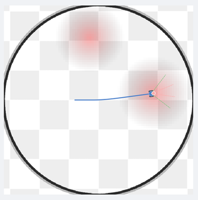
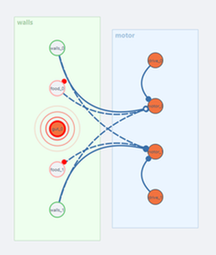

# The Belly Rules the Nose — Neuromodulation

A hungry animal and a full one can have exactly the same eyes, nose and wiring, and still behave very differently when they smell food. The difference is not in *where* signals go but in *how strongly* they get through. Internal state turns the volume of the senses up or down.

In this tutorial you will build a vehicle that lives in a round arena with two food patches. It circles the arena, eats at one patch, and then **ignores the second patch** it meets, because a hormone released by its gut is turning down its sense of smell. By the time it comes round to food again, the hormone has worn off. The robot is hungry again and eats. No wire is added or removed between those two moments. Only the gain of the food sensor changes.

**What you will build**

| Step | What happens |
|------|--------------|
| Set up the arena | A round arena with two food patches (gradient `A`) |
| Build an always-hungry vehicle | Constant drive, wall avoidance and food approach, the same wiring as Vehicle III |
| Watch it overeat | It stops at *every* patch it meets |
| Give it a gut | An `InteroceptiveSensor` that fills up while the robot eats and releases **insulin** |
| Put insulin receptors on the nose | The food sensor's gain becomes `1 − insulin` |
| Watch it skip a meal | Fed at one patch, it passes the next one by and eats again once it is hungry |

---

## Background

Neuromodulators — hormones, neuropeptides — are not point-to-point wires. They flood a tissue and change the gain of every cell that carries the matching receptor. One slow signal retunes a whole pathway at once.

This happens at the **first synapse of the olfactory system** in both flies ([Root et al., 2011](#references)) and mice ([Oncul et al., 2026](#references)): when satiated, circulating insulin reduces how strongly food odours drive the brain. When hungry, the gain is restored. [Sengupta (2013)](#references) shows the same principle across *C. elegans* and *Drosophila* — feeding state routinely gates smell and taste right at the peripheral sensory neuron.

You will build exactly that: a `GradientSensor` as the nose, an `InteroceptiveSensor` as the gut that releases insulin onto the neuromodulator bus, and an insulin receptor on the nose that scales its output down when the gut is full.

---

## Step 1 — Set up the arena

1. In the **Physics** tab, set **arena_scale** to `4` so the arena is big enough to circle. 
2. In the **World** tab, place two gradient-`A` patches (the red **A** button, then drag from the centre outwards). Put one at around North and the other around West, making sure the patches are far enough from the wall to observe a movement from the robot towards them but close enough to allow the robot to sense them with one of its antenae. These are the two meals.
3. Leave the robot near the middle, slightly left of centre.

---

## Step 2 — Build a wall-following robot

Create a new network in the **Brain** tab (**Network** mode, **+**, call it `Feeding`) and open the visualizer. You'll add three things the robot already knows from the earlier tutorials.

**A reason to move.** Drag a **ConstantLayer** onto the canvas, name it `drive`, `n = 2`, `value = 50`. Wire `drive → motor` with the identity matrix:

|  | `drive_0` | `drive_1` |
|--|--|--|
| `motor_0` | **1** | 0 |
| `motor_1` | 0 | **1** |

**A way to stay off the walls.** Drag a **DistanceSensor**, name it `walls`, `n = 2`, `angle_spread_deg = 60`, `max_range = 1.0`, `scale = 50`. Wire `walls → motor`:

|  | `walls_0` (left) | `walls_1` (right) |
|--|--|--|
| `motor_0` (left wheel) | **+1** | **−1** |
| `motor_1` (right wheel) | **−1** | **+1** |

A wall close on the left speeds up the left wheel and slows the right one, so the robot turns right, away from the wall. In a round arena this keeps the robot sliding along the boundary. Try it!

**Save.**

---

## Step 3 — Build an always-hungry vehicle

**A nose for food.** Drag a **GradientSensor**, name it `food`, `n = 2`, `gradient = A`, `angle_spread_deg = 30`, `scale = 30`. Wire `food → motor` **same-side inhibitory**, the Vehicle III approach wiring:

|  | `food_0` (left) | `food_1` (right) |
|--|--|--|
| `motor_0` (left wheel) | **−1** | 0 |
| `motor_1` (right wheel) | 0 | **−1** |

More food smell on the right slows the right wheel against the constant drive, so the robot curves toward the food (see [Braitenberg Vehicle III](second-braitenberg.md)).

**Save.**

Press **▶ Run**. The robot circles the arena. Each time it passes near a patch, the food smell pulls it in, and it slows and crawls through the patch. Then it continues along the wall to the next patch and does exactly the same thing. **It stops to eat at every patch it meets, every lap, forever.**

This vehicle has no internal state. Its response to food depends only on what it smells right now, never on what it has already eaten. A real animal that did this would spend its whole life at the food it last found.

---

## Step 4 — Give it a gut that releases insulin

1. Drag an **InteroceptiveSensor** onto the canvas and name it `gut`. On the **Sensor** tab set:
    - `gradient` → `A`, so it "tastes" the same food the nose smells
    - `scale` → `1`, `max_val` → `1`, `start_val` → `0` (starts with an empty stomach)
    - `tau_rise` → `2.0`, so about two seconds of eating at the patch centre fills it
    - `tau_decay` → `5.0`, short enough to watch the belly empty in real time
2. Switch to the **Neuron** tab and set:
    - **neuromodulator transmitter** → `insulin`
    - **transmitter color** → `#FF0000`
3. Confirm and **Save**.

Don't draw any connection from `gut`. A transmitter doesn't need one: every tick, `gut` publishes its output as the value of `insulin` on the network's neuromodulator bus, and anything that has an insulin receptor reads it. That's the point of a hormone.

`gut` samples food at the robot's **mouth** (the front of the body). The deeper the robot goes into a patch, the faster it eats, so a long stay at the edge of a patch fills it as surely as a quick bite at the centre. See [InteroceptiveSensor](../sensors/interoceptive.md) for the full dynamics.

Nothing in the circuit responds to insulin yet — no receptor exists — but the hormone is already being secreted and cleared exactly as intended.

!!! note 
    Add `gut` to the oscilloscope, switch the robot to **manual** mode and press **▶ Run**. Drag the robot onto a food patch and watch the trace climb; drag it away and watch the belly empty over about 5 seconds. Push it in and out a few times — a second visit while the gut is still elevated starts from a higher baseline. If the trace is too small, increase `gut`'s scale factor in the oscilloscope.

---

## Step 5 — Put insulin receptors on the nose

!!! info "One sensor, three knobs"
    Every sensory neuron has two fixed stages and can carry a third dynamic one.

    **Stage 1 — Sensor scale / bias.** Input: raw reading $r \in [0,1]$. Output:

    $$s = k_s\, r + b_s$$

    With $k_s = 30$, $b_s = 0$: $s = 30 \times 0.5 = \mathbf{15}$. Fixed for the whole run.

    **Stage 2 — Neuron scale / bias.** Input: $s$ from Stage 1. Output:

    $$y = f(k_n\, s + b_n)$$

    With $k_n = 1$, $b_n = 0$, $f =$ identity: $y = \mathbf{15}$. A non-zero $b_n$ sets a threshold. Also fixed.

    **Stage 3 — Neuromodulator receptor.** The receptor computes a gain $g = 1 + k_r\, m$ from the hormone signal $m$ and intercepts the pipeline at the input site, scaling $s$ before Stage 2:

    $$y' = f(k_n \cdot g \cdot s + b_n)$$

    With $k_r = -1$, $m = 0.5$: $g = 0.5$, so $y' = f(1 \times 0.5 \times 15 + 0) = \mathbf{7.5}$ instead of $y = 15$ — the same stages, the same fixed knobs, a different gain every tick.

    That is the whole idea of this tutorial: Stages 1 and 2 are wired once; Stage 3 lets a slow internal signal retune the gain on the fly.

Before wiring the receptor, raise `tau_decay` on `gut` to `30` — the 5 s digestion was useful for watching the trace, but the robot needs to stay full long enough to skip the second patch.

1. Double-click `food` and switch to its **Neuron** tab.
2. Under **Modulator receptors**, click **Add Receptor** and fill the row in:

    | Modulator | Scale | Site | Mode |
    |---|---|---|---|
    | `insulin` | **−1.0** | `pre` | `absolute` |

3. Confirm and **Save**. Small red circles now appear in the `food` neurons signaling they are sensitive to the insulin neuromodulator you created.

{ style="display:inline-block; margin-right:24px; vertical-align:top;" }
{ style="display:inline-block; vertical-align:top;" }

Each tick, the receptor scales what arrives at `food`'s neuron by a gain:

$$\text{gain} = 1 + \text{scale} \times \text{insulin} = 1 - \text{insulin}$$

| `insulin` (gut) | gain | What the food smell does |
|---|---|---|
| 0 (empty) | 1.0 | full strength, strong approach |
| 0.25 | 0.75 | slightly weaker pull |
| 0.5 | 0.5 | half strength, weak pull |
| 1 (full) | 0 | nothing, the robot is blind to food |

Insulin can only turn the food sense *down*, from 100 % when empty to 0 % when full. It never increases the signal, and it never flips its sign.

!!! note "Why `pre`?"
    A receptor can act at two sites. Call the sensor reading $r$ and the neuron's output $y$.

    With `pre`, the gain multiplies the input before the neuron processes it:

    $$y = f\!\left((1 + s \cdot m)\, r\right)$$

    With `post`, the gain multiplies the output after the neuron has done its work:

    $$y = (1 + s \cdot m)\, f(r)$$

    When the neuron is a simple pass-through ($f(r) = r$), the two are identical. But once $f$ is nonlinear — a relu, a leaky filter, a bias — the results differ. A `pre` gain shifts the neuron's operating point, changing which inputs cross a threshold. A `post` gain scales the output uniformly, leaving the neuron's internal dynamics unchanged.

    Here, `food`'s neuron stage is pass-through, so `pre` and `post` give the same result. Using `pre` throughout the tutorial is the more principled choice: it gates the signal at the input, before any processing, which is the natural model of a presynaptic receptor. In Challenge 1 you will see the difference matter.

!!! warning "Keep the scale at −1 or weaker"
    With `gut` capped at `max_val = 1`, a scale of `−1` takes the gain exactly to zero when full — the nose is shut off but never reversed. A stronger scale (e.g. `−2`) would push the gain *negative*: food would start to *repel* the robot instead of just being ignored.

---

## Step 6 — Run it: skipping a meal

Press **▶ Run**, and add `food_0` / `food_1` to the oscilloscope alongside `gut`. You should see a cycle like this:

1. **Hungry.** `gut` is 0 and the gain is 1. The robot is pulled into the first patch it meets.
2. **Eating.** With its mouth in the patch, `gut` climbs over a couple of seconds (`tau_rise = 2`), faster the deeper the robot goes. The gain falls with it, the food signal fades, and the pull that held the robot in the patch weakens. The constant drive and the wall avoidance take over again, and the robot drifts out of the patch and back onto its path along the wall.
3. **Full, passing food by.** The next patch comes up soon after, because the two patches are close together. `gut` has barely started to empty, so the gain is still low. The weak food signal is not enough to pull the robot off its path, and it skirts the patch and keeps going.
4. **Hungry again.** On the longer stretch of wall that follows, `gut` decays (`tau_decay = 30` s) and the gain climbs back towards 1. The next time the robot meets food, it turns in and eats. The cycle repeats every lap.

Now try the receptor scale at `0` (effectively no receptor), `−0.5` and `−1`:

| Receptor scale | Gain when full | Patch it reaches hungry | Patch it reaches just after eating |
|---|---|---|---|
| none (`0`) | 1.0 | eats | eats as well, so the robot stops at every patch |
| `−0.5` | 0.5 | eats | weaker pull, may still turn in |
| `−1` | 0 | eats | **skipped** |

Same sensors, same wiring, same world. A single receptor on the nose, fed by a signal from the gut, decides which food the robot eats.

!!! tip "It's all about dynamics!"
    Note that nothing in the network says "skip this patch". After the robot leaves food, `gut` decays as `gut(t) ≈ gut₀ · e^(−t/30)`. If it leaves with `gut ≈ 0.8`, then 10 s later `gut ≈ 0.57` and the gain is only about 0.43. 60 s later `gut ≈ 0.11` and the gain is back to about 0.89. A patch reached soon after a meal is met with a weak nose, one reached much later with a strong one. Change the patch spacing, the starting position or `tau_decay`, and a different meal gets skipped, or none, or two. This is computation leveraging neural dynamics.

---

## Challenges

### Challenge 1 — Hunger turns the gain *up*

In the circuit you built, a full gut turns the nose *down*. The relationship can also run the other way: hunger turns the nose *up*. Build a robot that, when hungry, turns into a food patch from its edge, and that, when fed, only reacts once it is already well inside one, using a receptor with a **positive** scale.

??? tip "Solution — what changes and why"
    1. **Transform satiation into hunger on `gut`'s Neuron tab: `bias = −1`, `scale = −1`, transmitter → `ghrelin`.** The neuron computes `−(gut − 1) = 1 − gut`, so the signal is 1 when empty and 0 when full. The receptor gain is `1 + scale × signal`, so a positive receptor on a *fullness* signal would boost sensitivity when fed — the transmitter has to be high when the robot is hungry.

    2. **Make hunger amplify the smell: replace `food`'s insulin receptor with `ghrelin`, scale `+1`, site `pre`.** The gain is `1 + ghrelin`: 1 when fed, 2 when starving. It must be `pre`, so the smell is amplified *before* the threshold of step 3. With `post`, hunger would only scale the output after the threshold, and a strong smell would get through whether the robot is hungry or not.

    3. **Give the smell a threshold: on `food`'s Sensor tab set `scale = 10`; on its Neuron tab set `bias = −3` and `activation = relu`.** The smell now runs from 0 at the patch edge to about 10 at the centre, and the neuron passes only the part above 3. A fed robot (gain 1) gets a signal only well inside a patch, where the smell is above 3. A starving robot (gain 2) doubles the smell first, so a smell of 1.5 already gets through, and it reacts from near the edge, which is where it decides whether to turn in. Don't make the threshold too strict: at `−10` even a starving robot's doubled edge smell stays below it, and the robot ignores food altogether. The bias must be on the **Neuron** tab: the Sensor tab's bias is added to the raw reading (0 to 1) before the sensor's scale, so it would silence the nose instead of setting a threshold (see [Sensor bias vs neuron bias](../sensors/index.md#sensor-bias-vs-neuron-bias)).

    4. **Make a stronger smell steer, not stall: rewire `food → motor` as crossed excitation (`food_0 → motor_1`, `food_1 → motor_0`, weight `+1`), the Vehicle II wiring.** With the same-side inhibition from Step 3, a doubled smell pushes both wheels toward zero, and the hungry robot stops dead in the patch. With crossed excitation, smell on the left speeds up the right wheel, so a stronger smell just turns the robot harder toward the food.

    5. **Keep the smell sharp and the hormone immediate: leave `tau_rise` and `tau_decay` empty on `food`'s and `gut`'s Neuron tabs.** A time constant on `food`'s neuron smears the smell over seconds and destroys the left/right difference needed for steering. One on `gut`'s neuron adds a second lag on top of digestion, and because the filter starts at 0, the robot begins each run behaving as if it were full.

    To see the effect, at least one patch must sit a little *off* the robot's path along the wall. A patch the robot drives straight over gets crossed whether it is hungry or not; only a patch it has to turn toward shows the difference.

    The first lap may look different: the robot starts starving, and the excitation rushes it *through* the patch rather than slowing it down, so the gut may only half-fill and it eats at the next patch too. If that happens, shorten `gut`'s sensor `tau_rise` to `1` so a quick pass fills it.

### Challenge 2 — A hungry animal takes risks

A hungry animal takes risks a fed one avoids. Here the arena's walls are **hot** and the food sits right against them, so to eat, the robot has to brave the heat.

Start from the Challenge 1 robot, where `gut` broadcasts `ghrelin` (1 when empty, 0 when full). Make the robot avoid the hot walls when fed, and approach the food patches when hungry.

!!! note "Making the walls hot"
    In the **World** tab, select label `B`, click **Wall** in the *Gradients* row and drag inward from the edge. The drag distance sets how far the heat reaches into the arena. 

    
## References

- Root et al. (2011). Presynaptic facilitation by neuropeptide signaling mediates odor-driven food search. *Cell* 145. [doi:10.1016/j.cell.2011.02.008](https://doi.org/10.1016/j.cell.2011.02.008)
- Sengupta (2013). The belly rules the nose. *Curr. Opin. Neurobiol.* 23. [doi:10.1016/j.conb.2012.08.001](https://doi.org/10.1016/j.conb.2012.08.001)
- Oncul et al. (2026). Insulin controls olfactory gain at the first central synapse. *bioRxiv* (preprint). [doi:10.64898/2026.07.22.740090](https://doi.org/10.64898/2026.07.22.740090)
