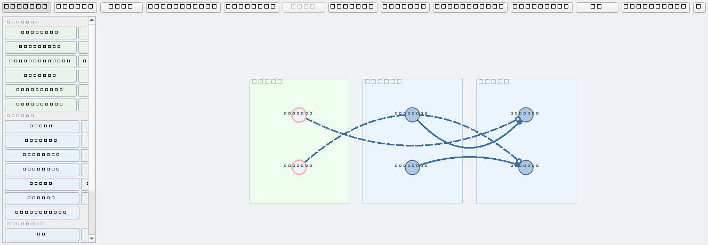

# Braitenberg Vehicle III: Intrinsic Drive

This tutorial picks up exactly where **[Braitenberg Vehicle II](first-braitenberg.md)** left off. There, the robot only ever moved because something was pulling on its sensors — crossed or same-side, excitatory wiring only ever reacts. You saw the cost of that in [Step 8](first-braitenberg.md#step-8-keep-it-moving): the instant the patch falls out of sensor range, both motors get a flat-zero command and the robot stops dead, no matter how many patches you scatter to catch it in time.

This time you fix that from the *inside*: a tiny addition to the circuit gives the robot a reason to move that has nothing to do with what it senses. Braitenberg called this an **intrinsic drive**, and vehicles that have one — his *Vehicle 3* — behave noticeably more like creatures than reflex machines.

**What you will build**

| Step | What happens |
|------|--------------|
| Add a constant drive | Both motors get a steady baseline speed from a `ConstantLayer` — no sensors wired in at all |
| Make the sensor inhibitory | The light sensor now *subtracts* from that baseline instead of adding to it |
| Observe "love" | The robot cruises on its own, slows as it nears the patch, and settles close to it instead of colliding or stopping |
| Cross it | Same inhibitory wiring, crossed instead of same-side — the robot flees the patch, but, unlike Vehicle II, never stops moving |

---

## Background — the missing ingredient

Vehicle 3 keeps the exact same body and the exact same sensor as Vehicle 2. Only two things change:

- The sensor connection becomes **inhibitory** (a negative weight) instead of excitatory.
- A **`ConstantLayer`** feeds both motors a steady baseline value, completely independent of any sensor.

That baseline is the intrinsic drive: with it, the robot moves even when there is nothing around to react to. The sensor no longer *causes* motion — it only *modulates* motion that is already happening, speeding up one wheel relative to the other or slowing the robot down as it nears a source. Braitenberg called the resulting behaviour **love**: the vehicle approaches a stimulus and settles near it, rather than lunging at it (pure excitation) or needing it just to move at all (Vehicle II's problem).

---

## Step 1 — Reopen your Vehicle II network

Launch the simulator, click the **Brain** tab, and select the network you saved at the end of Vehicle II (named `Braitenberg`, unless you called it something else). Click **⬡ Open visualizer**.

You should see the same two nodes as before: `light` (a `GradientSensor`, `n=2`, `scale=60`, `gradient=A`) and `motor`, however you last wired them. The exact weight matrix on that connection doesn't matter — you're about to replace it.

!!! note "Skipped Vehicle II?"
    Build the same starting point: a `GradientSensor` named `light` (`n=2`, `gradient='A'`, `scale=60`) and a `MotorLayer` named `motor`, with one connection between them. See Vehicle II, [Step 4](first-braitenberg.md#step-4-add-a-light-sensor) and [Step 5](first-braitenberg.md#step-5-wire-for-attraction), for the details.

---

## Step 2 — Add the constant drive

1. Drag a **ConstantLayer** chip from the palette onto the canvas.
2. In the dialog, set:
    - **name** → `cruise`
    - **n** → `2`
    - **value** → `60`
3. Confirm. The `cruise` node appears with two neuron circles.

`ConstantLayer` has no separate scale factor — `value` *is* the number that reaches the motor. Setting it to `60` matches `light`'s own `scale`, which will matter once the sensor is wired in (Step 5).

---

## Step 3 — Wire the cruise baseline

Drag from `cruise` onto `motor`. In the weight-matrix editor, choose **Manual** and enter the identity matrix:

|  | `cruise_0` (left) | `cruise_1` (right) |
|--|--|--|
| `motor_0` (left wheel) | **1** | 0 |
| `motor_1` (right wheel) | 0 | **1** |

Confirm and **Save**.

---

## Step 4 — Run it with no patch at all

Go to the **World** tab and delete every patch in the arena (right-click each one). Press **▶ Run**.

The robot drives forward on its own, at a steady speed, with absolutely nothing in the world to react to. Nothing you built in Vehicle II could ever do this — without a stimulus, those motors always read zero. This one keeps going because `cruise` doesn't look at the sensors at all.

---

## Step 5 — Make the sensor inhibitory

Stop the simulation. Place an `A` patch back in the arena (World tab, as in Vehicle II Step 2). Then rewire `light`'s connection into `motor`:

1. Right-click the `light → motor` connection → **Edit weight…**.
2. Choose **Manual** and enter the *same-side*, negative matrix:

    |  | `light_0` (left) | `light_1` (right) |
    |--|--|--|
    | `motor_0` (left wheel) | **−1** | 0 |
    | `motor_1` (right wheel) | 0 | **−1** |

3. Confirm and **Save**.

Each motor now receives `cruise`'s baseline of `60` *minus* its own-side sensor reading. Because `light`'s `scale` (`60`) matches `cruise`'s `value` (`60`), a sensor reading at full strength cancels its own motor exactly: `60 − 60 = 0`.

---

## Step 6 — Run it: observe "love"

Press **▶ Run**. Far from the patch, both motors sit near the `60` baseline and the robot cruises in a straight line. As it drifts close enough for, say, the left sensor to pick up more signal than the right, the left motor is inhibited more than the right — the relatively faster right wheel turns the robot **toward** the patch, and it slows the closer it gets. Watch it settle near the patch instead of stopping dead or driving straight through it.

!!! note "Not settling?"
    If the robot overshoots and keeps oscillating around the patch, your `light` scale and `cruise` value may not match closely enough — revisit Step 2 and Step 5's matching `60`s, or see the experiment below.

---

## Step 7 — Cross it: flee without stopping

Stop the simulation and switch the `light → motor` matrix to the crossed pattern instead:

|  | `light_0` (left) | `light_1` (right) |
|--|--|--|
| `motor_0` (left wheel) | 0 | **−1** |
| `motor_1` (right wheel) | **−1** | 0 |

Confirm, **Save**, and press **▶ Run** again. The robot now steers away from the patch — but unlike Vehicle II's avoidance vehicle, it never goes fully silent. Let it drive straight past the patch and out of sensor range entirely, the same way you did in [Vehicle II's Step 8](first-braitenberg.md#step-8-keep-it-moving): this time both motors settle back to the `60` cruise baseline instead of dropping to zero, and the robot just keeps going.

---

## Step 8 — Experiment

**Rebalance `cruise` and `light`**

Try `cruise`'s `value` at `100` with `light`'s `scale` left at `60`: the sensor can never fully cancel the baseline, so the robot barely slows down near the patch — the drive dominates. Now try the opposite, `light` scale `100` against `cruise` value `60`: at close range the sensor term overshoots past zero into negative motor output, so the near wheel briefly reverses — a much sharper turn than simple cancellation gives you.

**Smooth it out**

The motor response here is instantaneous — it jumps the moment a sensor reading changes. **[Wiring Brains](../wiring-brains.md#adding-memory-the-leakylayer)** shows how a `LeakyLayer` between `light` and `motor` turns that into a gradual, muscle-like response instead.

---

## What to try next

- **[Wiring Brains](../wiring-brains.md#vehicle-3-cruising-with-inhibition)** — the same Vehicle 3 circuit worked through algebraically, plus a `LeakyLayer` for smooth motor responses.
- **[Creating Worlds](../creating-worlds.md)** — all gradient, obstacle, and wall types in detail.
- **[Coding Brains](../coding-brains.md)** — if you want to express the same circuits in Python code instead.
