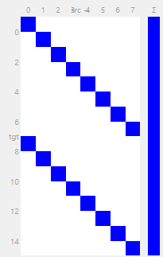
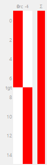
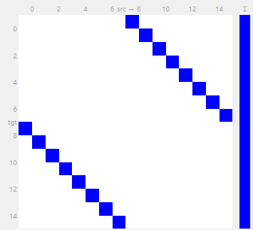
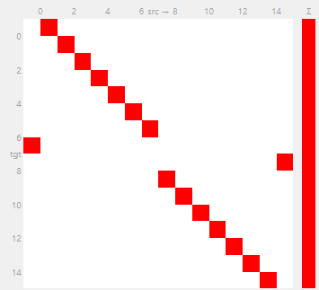

# Vector-Based Homing: Path Integration and Steering

This tutorial builds the compass half of an insect-style **path integration** circuit — the mechanism desert ants and bees use to walk home in a straight line after a long, winding foraging trip, without retracing their steps. You'll build it piece by piece in the network editor, using the exact parameters shipped in the built-in **Demos / D09 - VectorBasedHomingBrain** network, and see why each piece has to be there.

The circuit is based on Stone et al. (2017), *"An Anatomically Constrained Model for Path Integration in the Bee Brain"*, simplified down to the compass-only pathway (no optic-flow speed input — this version reads speed from the wheels instead).

**What you will build**

| Part | What it does |
|------|---------------|
| 1. Path integration | Combine a compass heading and a wheel-speed signal into a running "home vector" memory |
| 2. Homing | Compare that memory against current heading to produce a left/right steering signal |

---

## Background — why a population code?

A heading can be represented three ways: as `(x, y)` coordinates, as `(distance, angle)`, or as the amplitude and phase of a single cosine wave. All three are mathematically equivalent — but only the third is biologically realistic, because real neurons can't fire negative, so no single cell can *be* a signed cosine. Instead, the brain spreads it across a **ring of cells**, each tuned to a different preferred direction, each individually a clipped (half-wave-rectified) cosine. Added together, population-coded directions still add, subtract, and integrate as if they *were* cosines — which is exactly what this circuit relies on at every stage.

The ring in this network has **8 cells**, each one 45° apart.

---

## Part 1 — Path integration

### Step 1 — The compass (`TL`)

Add a **SkyCompassSensor** named `TL`:

| Parameter | Value |
|---|---|
| `n` | 8 |
| `scale` | 1.0 |
| `bias` | 0.0 |
| `phase` | 0.0 |
| `activation` | `relu` |

Each of the 8 `TL` neurons outputs `relu(cos(heading − sun_dir − k·45°))` — a half-wave-rectified cosine bump, zero for any direction more than 90° from current heading. This is the compass's raw signal: clean, but clipped to flat zero over half the ring.

!!! note "Ring neurons ≠ ring attractor"
    Don't confuse this with the biological "ring neurons" (ER neurons) of the ellipsoid body — those are a separate, visual-input cell type. `TL` here plays the role of **E-PG/CL1**, the actual compass-bump population.

### Step 2 — Clean the bump into a true sinusoid (`CL1`, `TB`)

Add a **RingAttractorLayer** named `CL1` (`n=8`, `tau_rise=0.1`, `tau_decay=0.1`, `activation=relu`, `bias=0.0`). Connect `TL → CL1` with the **One-to-one** preset (Amplitude `1.0`, Offset `0`) — a straight identity relay.

Give `CL1` a **self-connection** (`CL1 → CL1`) with an inhibition-dominated kernel: every row's weights must sum to a *negative* number, with near neighbours inhibited more weakly than far ones, so the ring settles into a single localized bump rather than firing uniformly (see the `RingAttractorLayer` reference page for the exact bump-formation checklist — row-sum sign, excitatory width, and tonic drive all matter).

!!! info "Why clean it up at all?"
    `TL`'s own output is already clipped to zero over half the ring, and a competitive ring attractor's bump is narrow and sharp — neither is a smooth, never-zero sinusoid. The next step needs one.

Now add a **LeakyLayer** named `TB` (`n=8`, `tau_rise=0.1`, `tau_decay=0.1`, `bias=1.5`, `activation=relu`, `scale=0.333333`). Connect `CL1 → TB` with the **Cosine** preset:

| Field | Value |
|---|---|
| Amplitude | 1.0 |
| Phase₀ | 0° |
| Phase step | 45° |
| Bias | 0 |

This makes every `TB` cell a weighted sum of **all eight** `CL1` cells, `W[i,j] = cos((i−j)·45°)` — a circulant cosine kernel. Mathematically, that's a discrete Fourier filter: it keeps only the ring's fundamental (one-bump-per-revolution) component and discards everything else, reconstructing a smooth sinusoid from whatever shape `CL1`'s bump actually has.

`TB`'s own `bias=1.5` and `scale=0.333333` then shift that sinusoid so it never touches zero: `1.5 × 0.333333 = 0.5` exactly, so `TB` oscillates in a band centred on 0.5 (roughly `[0.17, 0.83]`), always positive. That matters downstream, because the next step multiplies `TB` by a speed signal — and a signal that still hit zero at some directions would zero out speed in those directions too.

### Step 3 — Speed, from the wheels (`sensor2`, `TN2`)

Add a **ProprioceptiveSensor** named `sensor2` reading the `motor` joint (`use_velocity=false`, `scale=1.0`, `bias=0.0`, `activation=linear`) — this is the stand-in for the bee's optic-flow speed signal; a wheeled robot reads wheel rotation instead, which is really closer to a desert ant's *leg-based* stride integrator than to the original bee's visual odometer.

Add a **LeakyLayer** named `TN2` (`n=2`, `tau_rise=0.1`, `tau_decay=0.1`, `bias=0.0`, `activation=relu`). Connect `sensor2 → TN2` with a **Manual** matrix where every entry is `0.005`:

$$
W = \begin{pmatrix} 0.005 & 0.005 \\ 0.005 & 0.005 \end{pmatrix}
$$

Both `TN2` cells end up computing the *same* number — `0.005·(v_L + v_R)`, total forward speed — rather than the two differently-tuned channels the real bee circuit uses. That's a deliberate simplification: a wheeled base doesn't have two independent optic-flow axes to split speed across.

### Step 4 — Gate speed by heading (`TBGate`)

Add a **ProductLayer** named `TBGate` (`n=8`, `tau_rise=0`, `tau_decay=0`, `bias=0`, `activation=linear`). A `ProductLayer` **multiplies** the totals of its incoming connections instead of summing them — give it two:

- `TB → TBGate`: **One-to-one** preset, Amplitude `1.0` (identity).
- `TN2 → TBGate`: **Uniform** preset, Amplitude `1.0` — every `TBGate` cell receives `TN2_0 + TN2_1` (both channels, summed, broadcast identically to all 8 cells).

So `TBGate[k] = TB[k] · (TN2_0+TN2_1)` — the instantaneous "am I moving, and which way am I facing" signal for ring position `k`.

!!! warning "The hidden baseline"
    Because `TB` never goes below ≈0.17 (step 2), this product always contains a chunk that has nothing to do with direction: expand `TB[k] = 0.5 + wave(k)` and `TBGate[k] = 0.5·(TN2_0+TN2_1) + wave(k)·(TN2_0+TN2_1)`. The first term is identical at *every* ring position — pure contamination from the fact `TB` can't be silent. Step 5 cancels exactly that term.

### Step 5 — Integrate into a home vector (`CPU4`)

Add a **LeakyLayer** named `CPU4` (`n=16`, `tau_rise=0.0`, `tau_decay=0.0`, `bias=0.0`, `activation=hard_sigmoid`, `scale=1.0`, **`x0=0.5`**, **`output_mode=integral`**).

`CPU4` is split into two hemispheres of 8 cells each, both fed by the *same* `TBGate`/`TN2` signals (since `TN2_0=TN2_1` in this simplified version, the hemispheres end up numerically identical here — in the full biological model they'd carry genuinely different ±45°-offset speed channels). Wire two connections:

- `TBGate → CPU4` (**Manual**, weight `-1`): each `TBGate[k]` feeds *both* `CPU4[k]` and `CPU4[k+8]`.
- `TN2 → CPU4` (**Manual**): `TN2_0 → CPU4[0..7]` and `TN2_1 → CPU4[8..15]`, weight `+1` each — this is exactly the term that cancels `TBGate`'s hidden baseline from Step 4.

Both matrices are too big to type out cell by cell, but their shape is simple — each is just two 8×8 blocks stacked, written once with rows 0–7 as hemisphere A and rows 8–15 as hemisphere B:

$$
W_{TBGate \to CPU4} = \begin{pmatrix} -I_8 \\ -I_8 \end{pmatrix} \in \mathbb{R}^{16\times8}
\qquad\qquad
W_{TN2 \to CPU4} = \begin{pmatrix} \mathbf{1}_8 & \mathbf{0}_8 \\ \mathbf{0}_8 & \mathbf{1}_8 \end{pmatrix} \in \mathbb{R}^{16\times2}
$$

where $I_8$ is the 8×8 identity (one `-1` per row, on the diagonal within its own 8-column block) and $\mathbf{1}_8$/$\mathbf{0}_8$ are length-8 columns of all-ones/all-zeros. In the weight-matrix editor that's nothing more exotic than the one-to-one diagonals you've already wired in Steps 2–4 — just stamped down twice, once per hemisphere. Here's what each actually looks like in the editor's own **Preview** panel (rows = `CPU4` target, columns = source; red = excitatory, blue = inhibitory):

-   **`TBGate → CPU4`**
    {: style="text-align: center;" }

    

-   **`TN2 → CPU4`**
    {: style="text-align: center;" }

    

Each cell now integrates `TN2_hemisphere − TBGate[k]`, starting from `x0=0.5`, through `output_mode=integral` — literally `x(t) = 0.5 + ∫(TN2 − TBGate)dt`, accumulated once per simulation tick as `(…)·dt`, not as the raw value itself. Work through the algebra and the hidden baseline cancels exactly, leaving `CPU4[k] − 0.5 ∝ −∫v·cos(heading−dir_k)dt` — the **negative** of the outbound displacement, i.e. `CPU4` points **home**, not along the path travelled.

Because the accumulator is never clipped internally (only `hard_sigmoid` clips the *output*), this memory has a finite range: travel far enough in one direction and the cells aligned with it saturate, flattening the bump. That's not a bug to fix — real ants and bees have a measurably finite path-integration range too.

You've now built the full **path integration** half. Load the `Demos/D09 - VectorBasedHomingBrain` network and compare — `TL → CL1 → TB`, `sensor2 → TN2`, `TBGate`, `CPU4` are wired exactly as above (the rest of that network goes further than this tutorial does — see the end of this page).

### Step 6 — Watch it work: drive manually, watch `CPU4` fill up

Before moving on to the readout half, check that `CPU4` is actually doing what Step 5's algebra claims, by watching it update live instead of taking the math on faith.

1. In the Network Visualizer, right-click the `CPU4` node and choose **Add to activation panel**. The panel opens automatically with a 16-bar chart — one bar per `CPU4` neuron, bars 0–7 for hemisphere A and 8–15 for hemisphere B.
2. In the main Controls panel, enable **⌨ Manual** (Options row) to drive the robot with the keyboard while the brain keeps running. This does **not** bypass the circuit — `CPU4` is still fed by the exact same `TBGate`/`TN2` signals either way; only who's choosing the heading changes.
3. Press **▶ Run**, then drive in a straight line for a few seconds (`W`/`S` forward/back, `A`/`D` turn, `Space` stop). Both hemispheres start flat at `0.5` (that's `x0`). Watch the bars: because `TN2_0 = TN2_1` in this simplified circuit, hemisphere A and hemisphere B should move identically — if they don't, something's wired wrong.
4. Driving in one direction should push the cell(s) aligned with that heading away from `0.5`, while cells roughly opposite stay close to it — Step 5's `−∫v·cos(heading−dir_k)dt` shape, made visible instead of algebraic.
5. Turn around and drive back the way you came, same distance: those same cells should drift back toward `0.5`. `CPU4` accumulates *displacement*, not "time spent facing each direction" — a loop back to your start should leave it close to where it started too.

!!! tip "Pin `TB` too"
    Right-click `TB` → **Add to activation panel** and compare the two side by side: `TB`'s bump tracks your *current* heading instantly, while `CPU4` only drifts slowly in response — the difference between a compass and a memory.

---

## Part 2 — Homing: reading the vector back out

`CPU4` holds the home vector, but it's in world (compass) coordinates. Steering needs to know how that compares to **current** heading.

### Step 7 — Cross-compare hemispheres (`P`)

Add a **LeakyLayer** named `P` (`n=16`, `tau_rise=0.1`, `tau_decay=0.1`, `bias=0.0`, `activation=relu`). Connect `CPU4 → P` with **One-to-one**, Amplitude `1.0` — a plain relay; `P` is literally just a renamed copy of `CPU4` at this point. (Since this circuit's two hemispheres are numerically identical, this relay doesn't yet do anything interesting on its own — it's set up for the next step.)

### Step 8 — Compare to current heading (`CPU1`)

Add a **LeakyLayer** named `CPU1` (`n=16`, `tau_rise=0.1`, `tau_decay=0.1`, `bias=0.0`, `activation=relu`, **`noise_std=2.0`**, `noise_tau=1.5`). Wire three incoming connections:

- `P → CPU1`: **One-to-one**, Amplitude `-1`, **Offset `8`** — `W[i,j] = -1` where `j = (i+8) mod 16`. This crosses each hemisphere to the *other* hemisphere's matching ring position, negated.
- `CPU4 → CPU1` (**Manual**): hemisphere A shifts **+1 ring step**, *within its own 8-cell ring* (`CPU1[i] = CPU4[(i+1) mod 8]`, so `CPU1[7] = CPU4[0]` — it wraps, it does not spill into hemisphere B's columns), hemisphere B shifts **−1 ring step** the same way (`CPU1[i+8] = CPU4[8 + ((i-1) mod 8)]`, so `CPU1[8] = CPU4[15]`) — opposite directions, same 45° magnitude.
- `TB → CPU1` (**Manual**, weight `-1`): the *same* `TB[i]` cell feeds both `CPU1[i]` and `CPU1[i+8]` — current heading, unshifted, subtracted from both hemispheres. Same shape as `TBGate → CPU4` back in Step 5 — two stacked 8×8 negative identity blocks — just `TB` (8 cells) in place of `TBGate` here.

`P → CPU1` and `CPU4 → CPU1` are both full 16×16 matrices, and neither is a simple stacked block — here's the editor's own **Preview** for each (rows = `CPU1` target, columns = source; blue = inhibitory, red = excitatory):

-   **`P → CPU1`**
    {: style="text-align: center;" }

    

-   **`CPU4 → CPU1`**
    {: style="text-align: center;" }

    

Put together (for $i = 0..7$; the first term wraps mod 8 within hemisphere A, so read `CPU4[i+1]` as `CPU4[(i+1) mod 8]` — the `CPU4[i+8]` term from `P` needs no such wrap, since `i+8` never exceeds 15 here):

$$\text{CPU1}[i] = \text{CPU4}[i+1] - \text{CPU4}[i+8] - \text{TB}[i]$$

!!! info "Why the opposite shifts?"
    Shifting `CPU4` by +45° on one side and −45° on the other gives each hemisphere a *different vantage point* on the same stored vector — like sampling it from slightly left-of-centre and slightly right-of-centre. Subtracting the same `TB` from both breaks the left/right symmetry only when current heading doesn't match the stored direction: pointed straight at the goal, the two hemispheres balance; drift off course, and they diverge — exactly the asymmetry a differential-drive steering command needs. With no shift at all, both hemispheres would be identical and there'd be no way to tell left from right.

!!! info "Why the noise?"
    A heading-error signal built from subtracting cosines has not one but *two* zero-crossings: one where you're facing the goal (a stable point — nudge off it and the signal pushes you back), and one where you're facing **directly away** from it (an unstable point — nudge off it and the correction grows instead of shrinking, but *at* that point the signal is exactly balanced with no inherent left/right bias). `CPU1`'s unusually large `noise_std=2.0` — far bigger than anything else in this network — exists specifically to kick the system off that knife-edge so it reliably commits to turning one way or the other.

### Step 9 — Read it out (`Steering`, `Fw`, `motor`)

Stone et al.'s own readout is simple: **sum each hemisphere's `CPU1` activity and subtract**. Add a **LeakyLayer** named `Steering` (`n=2`, `bias=0.0`, `activation=relu`, **`scale=40.0`**). Connect `CPU1 → Steering` with a **Manual** matrix that flat-sums each hemisphere separately: `Steering[0]` sums all 8 cells of hemisphere A (weight `1` on `CPU1[0..7]`, `0` on the rest), `Steering[1]` sums hemisphere B the same way — the same flat-sum-per-hemisphere pattern the built-in `Demos/D09 - VectorBasedHomingBrain` network uses at its `CPU1 → DNa03` connection.

!!! warning "A flat sum doesn't work with a raw cosine"
    Summing a full-period cosine over evenly-spaced ring cells is **always exactly zero**, for any phase — there is nothing a flat sum could ever pick up from a clean, unclipped sinusoid. This only works because `CPU1`'s own `relu` (Step 7) has already clipped the negative half of the wave away; a half-wave-rectified cosine does not sum to zero. If you ever build a readout from a layer that *hasn't* been rectified, project onto a cosine template instead of summing flat, or you'll get zero regardless of the input.

Add a second **LeakyLayer** named `Fw` (`n=2`, `bias=40.0`, `activation=relu`) with **no incoming connections at all** — a constant forward-thrust term, completely independent of the vector circuit. Finally, add the **MotorLayer** and wire both `Steering → motor` and `Fw → motor` with **One-to-one**, Amplitude `1.0`, so `motor[i] = Steering[i] + Fw[i]`.

!!! danger "Gain matters more than you'd think"
    It's tempting to skip `Steering`'s `scale=40` and feed `CPU1`'s hemisphere sums straight into `Fw` alongside its `bias=40`. Don't — a raw hemisphere sum, after `relu`, is typically well under 1; next to a `bias` of 40 that's a difference of a fraction of a percent between the two motor outputs. The robot will look like it's just driving straight, even though the steering signal is technically present and correctly signed — it's just about 50× too small to matter. `Steering`'s `scale` is what makes the vector's influence big enough to show up; tune it by watching how sharply the robot corrects course, not by formula. The built-in `Demos/D09 - VectorBasedHomingBrain` network hides this exact amplification inside `DNa02`'s own `scale=50`, several layers downstream of `CPU1` — easy to lose track of if you're simplifying that circuit by hand.

---

## Going further

The built-in `Demos/D09 - VectorBasedHomingBrain` network implements a fuller version of this pathway — `Pontine`/`CPU1` feed into additional `PFL2`, `DNa03`, `DNa02` layers before reaching `motor`, rather than the direct `Steering`/`Fw` readout built above. Those extra stages come from *later* Drosophila connectome studies (Namiki et al. 2018; Rayshubskiy et al. 2020; Mussells Pires et al. 2024) layered on top of Stone et al.'s original 2017 bee model, not from Stone's paper itself — Stone's own circuit really does stop at `CPU1 → motor` (via one amplifying layer and a forward-drive bias), exactly as built above. Worth comparing both once you've built this version by hand.

An interactive explorer for the `CPU1` steering computation — sliders for the home-vector and heading cosine waves, live-updating output — lives in this repo's `analysis/vector_navigation/` folder (`cpu1_steering_interactive.py`) if you want to build intuition for Part 2 before wiring it up.

## What to try next

- **[RingAttractorBrain](../ringattractorbrain.md)** — the companion circuit: estimating heading from wheel rotation alone (no compass), using the same ring-population idea.
- **[RingAttractorLayer](../layers/ring_attractor.md)** — full parameter reference and bump-formation checklist for `CL1`.
- **[ProductLayer](../layers/product.md)** — how multiplicative gating (`TBGate`) differs from the usual summed connections.
- **[Wiring Brains](../wiring-brains.md)** — weight-matrix presets (Cosine, One-to-one, Mexican hat, …) in full detail.
