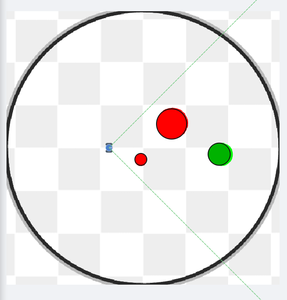
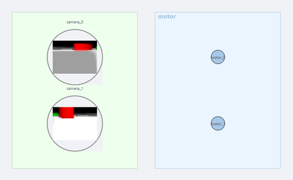

# Braitenberg Vehicles with Vision

The gradient-patch sensor used in earlier tutorials is a useful fiction: it gives the robot a tidy, single-number reading that represents "how much stimulus is nearby." Real eyes don't work that way. They send the brain a full image, and the brain has to extract from that image the signal it cares about.

This tutorial replaces the gradient sensor with a simulated RGB camera and a small convolutional layer that acts as a colour filter. The resulting Braitenberg circuit can distinguish objects by colour — approaching green ones and avoiding red ones — using the same crossed-and-same-side wiring logic you already know. No code is required.

**What you will build**

| Step | What happens |
|------|--------------|
| Place coloured objects | The arena has red and green solid objects |
| Add an RGB camera | A lateralized camera gives the robot left and right eyes |
| Add colour-opponent filters | A `Conv2dLayer` extracts redness and greenness from each eye |
| Add a constant drive | The robot keeps moving when nothing coloured is visible |
| Wire the motors | Crossed weights produce attraction to green, avoidance of red |
| Deploy on the robot | Wire the camera to a live ESP32-CAM stream |

---

## Background — from gradient patches to camera pixels

A `GradientSensor` ray returns a single float: the stimulus strength at the tip of the ray. That was enough for a colourless world.

A camera returns a `3 × H × W` tensor — three colour channels (R, G, B) over a grid of pixels. That's far more information, but the motor layer still expects just two numbers (left wheel, right wheel). Something has to collapse the image down into the numbers the motors need.

This circuit does it in two steps:

1. **Split the image left/right.** A lateralized camera gives the left hemisphere the left half of the image and the right hemisphere the right half. The robot now has a "left eye" and a "right eye," just like in the gradient-sensor case.

2. **Apply colour-opponent filters.** A `Conv2dLayer` with a 1×1 kernel treats every pixel independently. Each filter is simply a set of channel weights — `[+1, −1, 0]` for redness, `[−1, +1, 0]` for greenness. After global average pooling, each filter returns a single number per eye: how much red (or green) dominates in that half of the view. These two numbers per eye replace what the gradient-sensor ray used to give you.

3. **Wire the motors.** The four conv outputs (2 filters × 2 eyes) feed the two motor neurons through a crossed weight matrix. The result is a robot that steers toward green objects and away from red ones.

---

## Step 1 — Set up the world

1. Launch the simulator. Click the **World** tab.
2. In the *Objects* row, click **+ Add object** three or four times to place solid coloured circles in the arena. Use the colour picker on each to make two or three of them red and one green.
3. Drag the objects to spread them around the right half of the arena. Put the green one somewhere in the middle.

Objects are physical — the robot will bounce off them — which is what you want here. The robot's camera will see them as coloured regions as it approaches.

---

## Step 2 — Create a new network

1. Click the **Brain** tab and select **Network** mode.
2. Click **+** beside **Network** and name the new network `VisionBrain`.
3. Click **⬡ Open visualizer**. The canvas shows only the `motor` node.

---

## Step 3 — Add the RGB camera

The robot will see the world through a lateralized RGB camera: one image for the left half of its field of view, one for the right.

1. Drag an **RGBCameraSensor** chip from the palette onto the canvas, to the left of the `motor` node.
2. In the dialog, set:
    - **name** → `camera`
    - **width** → `64`
    - **height** → `48`
    - **FOV** → `90`
    - **lateralized** → ✓ (tick the checkbox)
    - **overlap** → `0`
3. Confirm. Two image nodes appear: `camera_L` and `camera_R`.

{ style="display:inline-block; margin-right:24px; vertical-align:top;" }
{ style="display:inline-block; vertical-align:top;" }

With `lateralized` ticked, the 64-pixel-wide image is split cleanly down the middle: the left 32 columns become `camera_L`, the right 32 columns become `camera_R`. Because `overlap = 0` there is no shared region — each eye sees a strictly separate half of the scene.

!!! tip "Run it now"
    Tick **⌨ Manual** in the Controls panel, then press **▶ Run**. Drive the robot toward the coloured objects with `W` / `S` / `A` / `D` and watch the two image nodes in the visualizer update as you steer — coloured objects slide in and out of the left and right eyes as the robot turns. Press **■ Stop** and untick **⌨ Manual** before continuing.

---

## Step 4 — Add colour-opponent filters

A `Conv2dLayer` with a 1×1 kernel acts as a pixel-independent colour filter: it multiplies each pixel by a set of channel weights and then averages the result across the whole image. With two filters you can compute both redness and greenness from each eye simultaneously.

1. Drag a **Conv2dLayer** chip from the palette onto the canvas, between the camera and the `motor` node.
2. In the dialog, set:
    - **name** → `color`
    - **n_filters** → `2`
    - **kernel_size** → `1`
    - **pool** → `global_avg`
    - **activation** → `relu`
    - **scale** → `50`
    - **lateralized** → ✓
3. Confirm. Two neuron-pair nodes appear: `color_L` and `color_R`, each with two circles.

---

## Step 5 — Connect camera to filters

Drag from **`camera_L`** onto **`color_L`**. Instead of the usual weight matrix, the **Filter Stack** dialog opens. It has three parts:

- **Presets** (left) — a column of buttons. Each click *adds* one filter to the stack.
- **Filter stack** (middle) — the filters this connection will apply, in order. Each filter becomes one output neuron of `color_L`.
- **Preview** (right) — a heatmap of the selected filter's kernel.

Build the stack:

1. Click **R−G**. A filter named `R−G` appears in the stack. Its kernel weights the red channel `+1` and the green channel `−1`.
2. Click **G−R**. A second filter appears below it, with the weights reversed: green `+1`, red `−1`.
3. Click **OK**.

The order matters: `R−G` becomes `color_L_0` and `G−R` becomes `color_L_1`. If you added them the other way round, drag them in the list to reorder, or select one and click **Remove selected** to start over.

You don't need to wire the right side. Because both the camera and the conv layer are lateralized, the simulator wires `camera_R → color_R` automatically, with its own copy of the same two filters. Both arcs appear on the canvas.

After `relu`, `R−G` is nonzero only when red is stronger than green in that half of the image, and `G−R` only when green is stronger than red. Each eye now outputs two numbers: how much red dominates on that side, and how much green dominates.

!!! note "Why 1×1 kernels?"
    A 1×1 kernel looks at one pixel at a time, so position in the image doesn't matter. Global average pooling then averages over the whole half-image. The robot steers by *how much* red or green it sees on each side, not by *where* the object sits within that side. For a Braitenberg vehicle that is enough: more red on the left than on the right means steer left.

!!! tip "Writing your own filter"
    The presets cover the common colour contrasts. For anything else, click **{ } Code filter…** at the bottom of the Presets column. You write a few lines of Python that assign a NumPy array of shape `(in_ch, kH, kW)` to `W`. Here that is `(3, 1, 1)`: three colour channels, one-pixel kernel. The names `np`, `in_ch`, `kH`, `kW` and the kernel centre `ch`, `cw` are predefined.

    This reproduces the `R−G` preset:

    ```python
    W = np.zeros((in_ch, kH, kW))
    W[0, ch, cw] =  1.0   # red
    W[1, ch, cw] = -1.0   # green
    ```

    Change the channel weights to build other detectors. For example, `W[0] = 1; W[1] = -0.5; W[2] = -0.5` responds to red against both green and blue. Give the filter a name and click **OK** to add it to the stack.

---

## Step 6 — Add a constant drive

Without a baseline, the motors only receive input when a coloured object is in view — the robot stops wherever the colour signal runs out. A `ConstantLayer` fixes this exactly as it did in Vehicle III.

1. Drag a **ConstantLayer** chip from the palette onto the canvas.
2. In the dialog, set:
    - **name** → `drive`
    - **n** → `2`
    - **value** → `50`
3. Confirm.

The `value` of `50` is on the same scale as the colour signals: the conv layer's `scale` of `50` means a half-image full of pure red drives its filter to `50`. In practice an object fills only part of the view, so the colour signals stay below the drive and steer the robot without overwhelming it. Raise `drive` and the robot cruises faster; raise `scale` and it turns more sharply.

---

## Step 7 — Wire the motors

Now connect the drive and the four colour neurons to the motor layer, with weights that produce attraction to green and avoidance of red.

### Drive → motor

Drag from **`drive`** onto **`motor`**. In the weight-matrix editor, choose **One-to-one** (or enter the identity matrix manually):

|  | `drive_0` | `drive_1` |
|--|-----------|-----------|
| `motor_0` (left) | **1** | 0 |
| `motor_1` (right) | 0 | **1** |

Confirm.

### color → motor

Drag from **`color_L`** onto **`motor`**. You only make this one connection. Because `color_L` and `color_R` are a lateralized pair, the weight-matrix editor covers both eyes at once: 2 rows (the motors) and 4 columns (the four colour neurons).

The columns follow the order the neurons are drawn on the canvas, top to bottom. The right eye is drawn mirrored, so its two neurons come in reverse order:

| Column | Neuron | Meaning |
|--------|--------|---------|
| 1 | `color_L_0` | red, left eye |
| 2 | `color_L_1` | green, left eye |
| 3 | `color_R_1` | green, right eye |
| 4 | `color_R_0` | red, right eye |

Choose **Manual** and enter:

|  | red L | green L | green R | red R |
|--|-------|---------|---------|-------|
| `motor_0` (left wheel) | **1** | 0 | **1** | 0 |
| `motor_1` (right wheel) | 0 | **1** | 0 | **1** |

Confirm. Click **Save** in the visualizer toolbar.

Read the matrix one colour at a time:

- **Green is crossed.** Green on the left drives the right wheel; green on the right drives the left wheel. This is Vehicle II's attraction wiring.
- **Red is same-side.** Red on the left drives the left wheel; red on the right drives the right wheel. This is Vehicle II's avoidance wiring.

The matrix is symmetric when you mirror it left-to-right: each eye is wired the same way as the other, just onto the opposite wheel.

---

## Step 8 — Run it

Close the visualizer (or leave it open alongside the arena). Press **▶ Run**.

Watch the robot. When a green object is on its right, `color_R_1` fires and speeds up the left wheel, so the robot turns right, toward the green object. When a red object is on its right, `color_R_0` fires and speeds up the right wheel, so the robot turns left, away from the red one.

Away from any coloured object, all four colour neurons sit near zero (`relu` removes the negative values), so both wheels run at the `drive` baseline of `50` and the robot drives straight.

!!! tip "Understanding the weight logic"
    This is the gradient-sensor Braitenberg wiring applied twice, once per colour: crossed for green (attraction), same-side for red (avoidance). Both run at the same time, so when red and green are both in view the two pulls compete, and the stronger colour signal wins.

---


## What to try next

- **[RGBCameraSensor reference](../sensors/rgbcamera.md)** — full parameter list including tilt angle and frame rate.
- **[Conv2dLayer reference](../layers/conv2d.md)** — larger kernels, pooling modes, and adaptation dynamics.
